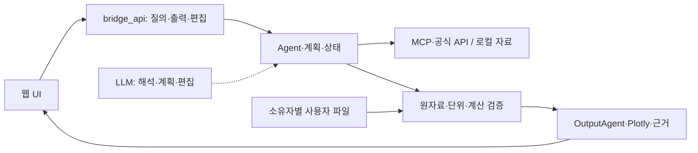
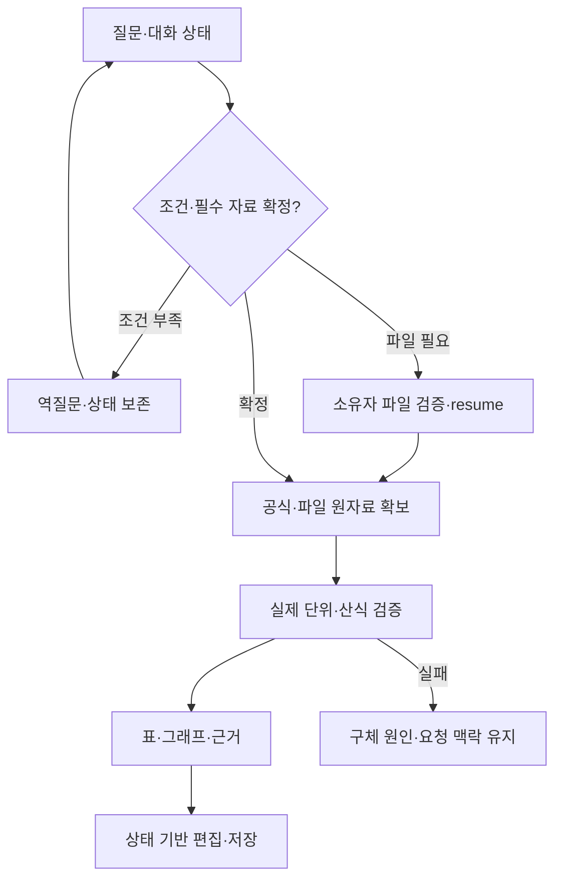

# StatBridge - 질문에서 검증 가능한 통계표·그래프까지

한국은행 통계표를 자연어로 찾고, 계열·기간·단위를 확인해 조회·계산·시각화하는 로컬 애플리케이션입니다. 핵심은 그래프 생성뿐 아니라 **어떤 원자료를 어떤 조건과 산식으로 사용했는지 확인하고, 실패한 요청을 같은 맥락에서 이어가는 과정**입니다.

**현재 범위:** local1의 공개 코드·메타데이터·개발 평가 문서입니다. 원자료 CSV 347개·API 키·벡터·사용자 저장 분석은 별도입니다. 팀 기여와 개인 후속 개선을 구분합니다.


[빠른 실행](#빠른-실행) · [결과](#결과) · [문제](#문제정의) · [구조](#아키텍처) · [상세 흐름](#상세-워크플로우) · [데이터](#데이터) · [시도](#시도와-개선) · [평가](#평가와-재현) · [한계](#한계) · [기여](#기여와-ai-활용)

## 빠른 실행

Windows에서는 압축 해제한 저장소 루트의 `START_STATBRIDGE.cmd` 또는 `scripts/windows/START_STATBRIDGE.cmd`를 실행합니다. Python 3.11~3.13 64비트와 Node.js 20.19+ 또는 22.12+를 확인하고, 가상환경·잠금 파일 기준 패키지를 준비합니다. 최초 설치에는 인터넷·설치 권한이 필요합니다.

키·원자료·계정별 저장 분석은 별도입니다. 벡터 인덱스가 없는 첫 실행은 사전 검색을 사용하며, 인덱스 생성은 별도 `--build-index` 단계입니다. [Windows 설치·환경 검사](docs/implementation/2026-10-13-windows-launcher-reliability.md), [기존 설치 상세](README_HISTORY.md#설치와-실행)

공개 평가 자료의 형식은 저장소 루트에서 다음과 같이 확인합니다. **모델·원자료 조회 평가가 아닙니다.**

```console
python eval/table-discovery/v4.1/scripts/validate_v41.py
```

2026-11-15 실행은 `VALIDATION OK`였습니다. [v4.1 평가 계약](eval/table-discovery/v4.1/README.md), [기여·검증 규칙](CONTRIBUTING.md)

## 결과

| 입력·단계 | 반환·화면 | 실제 코드·기록 |
|---|---|---|
| 조건이 부족한 질문 | 필요한 조건 질문과 요청 상태 | [질의 API](src/agent/bridge_api.py) |
| 확정한 표·계열·기간 | 원자료와 단위, 표·Plotly·근거 | [런타임](src/agent/agent_runtime.py), [출력](src/agent/output_agent.py) |
| 파생 계산에 필수 자료 누락 | 자료명·단위·출처 안내, 파일 보완 후 resume | [보완 실행](src/agent/derived_supplement.py) |
| 기존 출력의 자연어 편집 | 상태 기반 수정·되돌리기·파일 출력 | [편집 에이전트](src/agent/chart_edit_agent.py) |

모델의 계획, `execute=False`의 계획 검증, 실제 원자료 조회·계산 완료는 서로 다른 상태입니다. [표·그래프·파일 출력 사례](docs/implementation/2026-10-27-query-scope-and-export-fix.md)

## 문제정의

같은 이름의 지표도 평잔·말잔, 원계열·계절조정, 통화·지역·주기가 다르면 결과가 달라집니다. 표를 찾았다는 것만으로 올바른 값과 그래프가 만들어지지는 않았습니다. 후속 질문이나 파일 보완 뒤에 조건이 사라지고, 계산 실패가 자료 부재처럼 보이거나, 표시 기간과 계산에 필요한 선행 기간이 섞이는 문제도 있었습니다.

그래서 표 탐색, 실제 원자료 조회, 산식·단위 검증, 출력과 편집을 단계별로 분리했습니다. 모델의 제안은 서버가 검증하며, 수치는 승인된 KOSIS 원자료 또는 출처가 구분된 사용자 파일에서 가져옵니다.

## 아키텍처



| 책임 | 실제 경로 | 경계 |
|---|---|---|
| HTTP·화면 계약 | [bridge_api.py](src/agent/bridge_api.py), [frontend](src/agent/frontend) | `/api/query`, `/api/output`, `/api/output/edit` |
| 탐색·조회·계획 | [agent_runtime.py](src/agent/agent_runtime.py), [MCP](src/backend) | 정본 표·항목·분류와 요청 조건 유지 |
| 파생 계산·파일 보완 | [derived_supplement.py](src/agent/derived_supplement.py) | 사용자 파일은 공식 KOSIS 자료와 구분 |
| 출력·편집 | [output_agent.py](src/agent/output_agent.py), [chart_edit_agent.py](src/agent/chart_edit_agent.py) | 검증된 값·현재 상태로 편집 |

## 상세 워크플로우



### 단계별로 무엇을 확인하나

| 단계 | 처리와 출력 | 확인할 코드·문서 |
|---|---|---|
| 1. 요청과 상태 | 화면에서 질의·확정 조건·대화 상태를 API로 보냅니다. 제목·후보·폐기한 안을 실제 요청 조건과 구분합니다. | [화면](src/agent/frontend), [bridge_api](src/agent/bridge_api.py) |
| 2. 표와 계열 선택 | 일반 조회는 `resolve_request`에서 후보 표·계열·항목·분류·기간을 해석합니다. 필수 선택이 빠지면 질문하고 현재 맥락을 보존합니다. | [agent_runtime](src/agent/agent_runtime.py), [LangGraph 분기](src/agent/langgraph_workflow.py) |
| 3. 계산 계획 | 파생 요청은 입력 자료와 계산 트리를 계획하고 출처·주기·단위의 의미를 검사합니다. 조회 전 관측 단위가 비어 있는 상태와 실제 조회 후 단위 오류를 구분합니다. | [파생지표 설계](docs/implementation/2026-10-19-dynamic-derived-design.md), [단위 단계 보완](docs/evaluation/2026-11-02-ragas-llm-judge.md) |
| 4. 실제 자료 | MCP의 검색·메타·조회 도구가 KOSIS를 호출합니다. API 실패, 성공했으나 관측 없음, 승인 목록 밖 자료를 같은 사유로 합치지 않습니다. | [Backend·MCP](src/backend/statbridge_mcp), [워크플로우](src/agent/langgraph_workflow.py) |
| 5. 파일 보완 | 필수 자료가 없으면 필요한 이름·단위·주기·출처를 안내합니다. 계정별 CSV·JSON·TSV·XLSX 입력을 검증한 뒤 `/api/derived/supplement/{identifier}/resume`으로 이어갑니다. 파일 자료를 KOSIS 자료로 표시하지 않습니다. | [파일 형식과 출처](docs/derived_file_formats_and_sources.md), [보완·resume API](src/agent/bridge_api.py) |
| 6. 검산과 계산 | 실제 단위·결측·주기·계산량을 검사한 뒤 서버 계산 트리를 실행합니다. 이동 통계·시차에 필요한 조회 범위와 사용자가 볼 표시 범위를 구분합니다. | [기간·계산 보완](docs/implementation/2026-11-02-ragas-report-patch.md) |
| 7. 출력 | 조회·계산 결과를 세션으로 유지하고 `/api/output`에서 표와 Plotly를 만듭니다. 원자료 계열과 계산 계열의 표·그래프 표시 대상을 따로 둘 수 있습니다. | [OutputAgent](src/agent/output_agent.py), [출력 보완](docs/implementation/2026-10-27-derived-output-fix.md) |
| 8. 편집·내보내기 | `/api/output/edit`가 현재 chartState를 기준으로 수정합니다. 결과·단위·출처와 파일 표현을 확인하며, 실패한 수정이 기존 분석을 잃게 하지 않도록 복구합니다. | [편집 에이전트](src/agent/chart_edit_agent.py), [질의·출력 기록](docs/implementation/2026-10-27-query-scope-and-export-fix.md) |

역질문과 파일 보완은 한 HTTP 요청을 계속 열어 놓는 방식이 아닙니다. 질문·세션·업로드 작업을 보존하고 사용자 답변이나 `resume`의 새 요청으로 다시 진입합니다. `execute=False`의 계획 검증 성공은 실제 관측값 조회·계산 완료를 뜻하지 않습니다.

## 데이터

| 자료 | 역할 | 공개·검증 경계 |
|---|---|---|
| `data/processed/` 메타데이터 | 표·항목·분류 탐색과 계획 검증 | 추적되는 공개 자료 |
| 원자료 CSV 347개·공식 API | 관측값 조회 | CSV·키는 별도 공급. clone에 없음 |
| 소유자별 CSV·JSON·TSV·XLSX | 누락 원자료 보완 | 선언 단위·출처와 파일 해시 구분 |
| table-discovery v4.1 | 표 탐색 개발 평가 | dev/test 50/70, 공개 holdout 질의 30에는 정답 없음 |
| end-to-end·파생·UI 평가 | 다른 계약의 전체 흐름·출력 검토 | 표 탐색 점수와 혼용하지 않음 |

[파일 형식과 출처](docs/derived_file_formats_and_sources.md), [데이터·보류셋 경계](CONTRIBUTING.md)를 따릅니다. 비공개 평가 저장소·holdout 정답은 사용하지 않았습니다.

## 시도와 개선

| 겪은 문제 | 선택한 해결 방법 | 확인과 남은 한계 |
|---|---|---|
| 같은 이름의 다른 계열·분류를 선택 | 실제 메타데이터와 요청 조건으로 후보를 제한하고 필요한 조건만 재질문 | 개발 문항으로 검증했으며 모호한 표현의 완전 해석을 보장하지 않음 |
| 자료 확인과 계산 사이에서 맥락 유실 | 확정 조건·원질의·기간을 보존하고 파일 보완 후 같은 작업으로 재개 | 잘못된 파일·미지원 자료는 별도 안내. 공개본만으로 비공개 실행 자산 재현 불가 |
| 조회 전 빈 단위를 오류로 오인 | 계획 검토 단계의 조회 대기를 표시하고 실조회 후 단위 검증은 유지 | 11월 2일 Q05·Q06 별도 재실행 기록이며 전체 집단의 새 점수로 확장하지 않음 |
| 표시값과 계산·원자료 기간이 섞임 | 원래 정밀도와 표시 반올림, 수록·조회·표시 기간을 분리 | 저장 수치 검산과 화면 요약의 사실성은 각각 평가해야 함 |
| 그래프가 나와도 읽기·근거 확인이 어려움 | 표·그래프·근거·편집 상태를 함께 검토하고 파일 출력 대조 | 축 규모 차이, 내부 별칭, 복수 단위, 스크롤·약어 등 가독성 개선이 남음 |

## 평가와 재현

| 평가·검사 | 확인한 내용 | 근거 | 해석 한계 |
|---|---|---|---|
| 기존 v1.1 UI 개발 회귀 | 최초 응답 재채점 21/40, 패치 후 40/40 | [FULL_UI_REPORT](eval/min-e2e/v1.1/FULL_UI_REPORT.md) | 공개 개발 회귀·사람 승인 대기, 블라인드 일반화 아님 |
| 11월 2일 Judge·검산 | 최초 10문항, Q05·Q06 수정 후 두 문항 별도, Q10 저장 응답 재관찰 | [실행별 기록](docs/evaluation/2026-11-02-ragas-llm-judge.md) | 합쳐 단일 10/10·새 확정 평균으로 표시하지 않음 |
| v4.1 형식 재검사 | 2026-11-15 `VALIDATION OK` | [검증기](eval/table-discovery/v4.1/scripts/validate_v41.py) | 데이터 형식·공개 경계 확인이며 검색 정확도 아님 |
| 필수 pytest 시도 | 이번 환경에서 collection 오류 64개, langgraph 등 의존성 미충족 | [필수 검증 규칙](CONTRIBUTING.md) | 테스트 통과로 표시하지 않음 |
| 프런트 빌드 시도 | 환경의 pnpm 설치/심볼릭 링크 권한 단계에서 중단 | [frontend 설정](src/agent/frontend/package.json) | 빌드·UI 성공 미검증 |

RAGAS Faithfulness, LLM 화면 Judge, 저장 수치 검산은 별개입니다. 원 응답·캡처·생성된 평가 결과는 공개하지 않으며, 이번 작업에서 유료 모델·공식 API·전체 E2E를 새로 실행하지 않았습니다. 재현 명령과 평가 계열의 구분은 [기여 규칙](CONTRIBUTING.md)과 각 평가 문서를 따릅니다.

## 한계

| 한계 | 영향 | 현재 대응·남은 검증 |
|---|---|---|
| 원자료·키·벡터·개인 분석 별도 | clone만으로 모든 결과 재현 불가 | 필요한 자산을 별도 공급 |
| 모호한 지표·미지원 외부 자료 | 잘못된 대체 조회 위험 | 조건 질문·범위 밖 안내·출처별 파일 보완 |
| 정의·단위·결측 미확정 | 계산·출력 실패 가능 | 실제 단위 검증·원인 유지, 임의 계산 안 함 |
| 공개 개발 평가·사람 승인 대기 | 일반화·정성 품질 확정 불가 | 독립 검증·사람 리뷰를 분리 |
| 표·복수 단위·축·약어·스크롤 | 값이 맞아도 읽기 어려울 수 있음 | 화면·파일 표현을 별도 검토 |

## 기여와 AI 활용

Backend·Data·MCP 영역과 개인 후속 개선을 [기여 설명](docs/APPLICATION_PORTFOLIO.md)·구현 기록·Git 변경으로 연결합니다. 팀의 전체 코드를 개인 단독 개발로 주장하지 않습니다. 제품의 모델은 해석·계획·편집을 돕고, 원자료와 산술 검증은 서버가 맡습니다. AI 코딩 도구로 개발·평가·문서 작업을 수행했으며(ai-assisted), AI 판정을 사람 검토·승인으로 표시하지 않습니다.

## 상세 문서와 이전 기록

[기여·공개 경계](CONTRIBUTING.md) · [개인 기여](docs/APPLICATION_PORTFOLIO.md) · [자료 보완](docs/derived_upload_flow.md) · [최근 평가 기록](docs/evaluation/2026-11-02-ragas-llm-judge.md)

[이전 README 전체 기록](README_HISTORY.md)은 기존 시연·설치·기술 스택·기능별 기록과 측정 조건을 보존한 스냅샷입니다. 현재 실행 경계와 새 문서의 기준은 위 본문을 따릅니다. 이번 변경은 공개 코드·문서·평가 대조에 AI 코딩 도구를 사용했습니다(ai-assisted). 자동 병합하지 않습니다.
